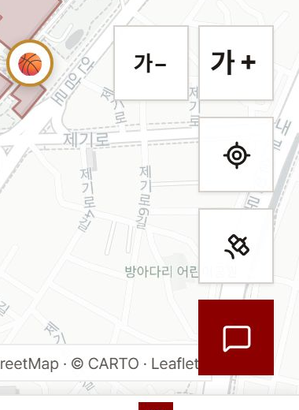
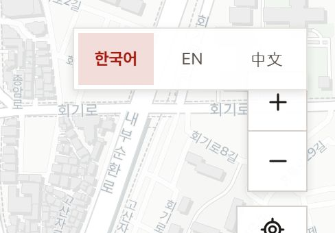
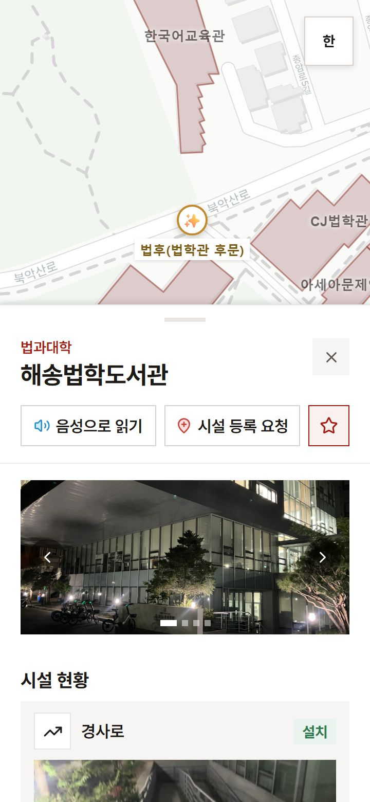
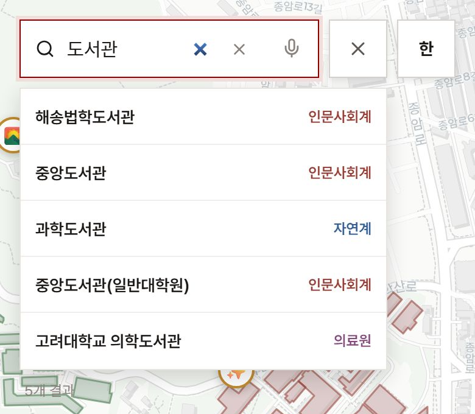
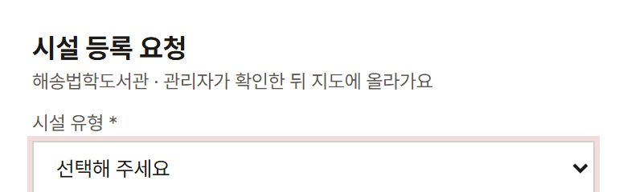
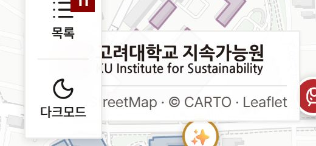
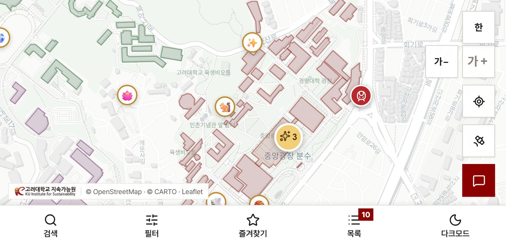
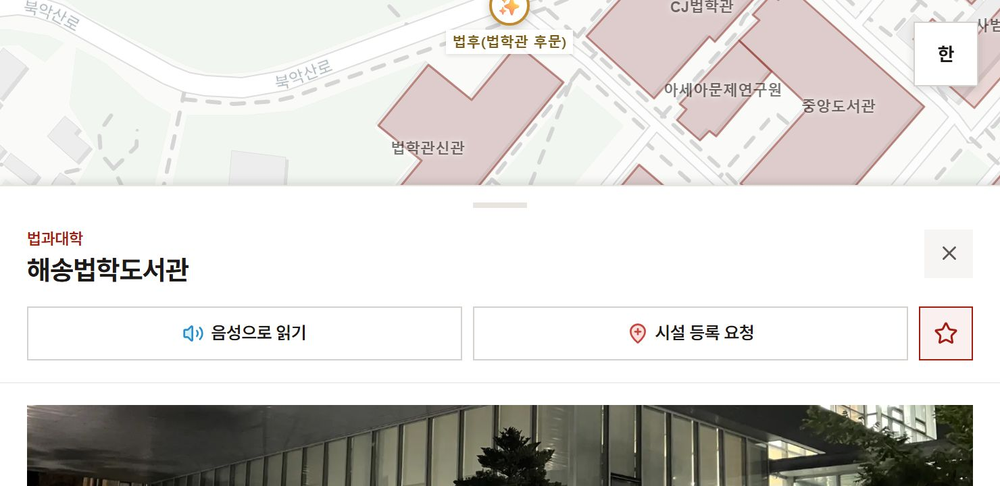
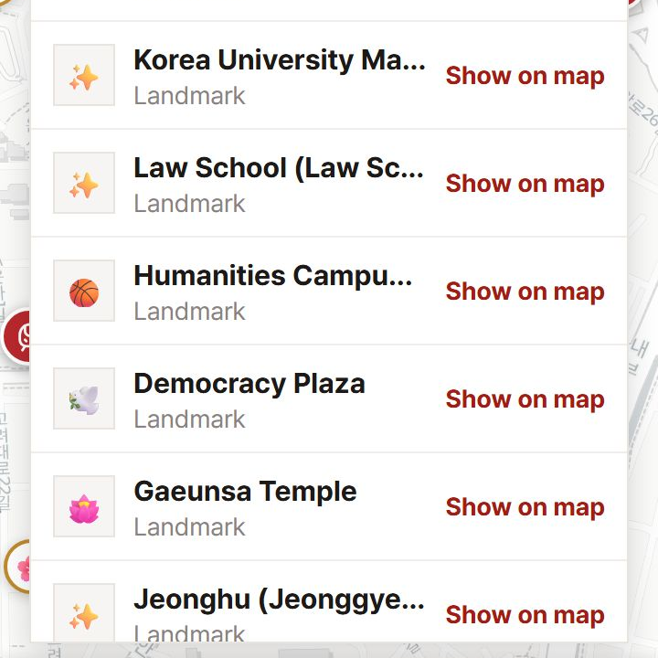

# 모바일 점검 (멘토링 ⑦)

- 점검일: 2026-10-28
- 대상: 운영 공개 지도 `https://korea-univ-project.vercel.app/`, 배포 커밋 `7a7c293`(⑥ 글자 크기까지 병합된 상태)
- 요구: `docs/specs/2026-10-25-mentoring-feedback-design.md` 9장 — 휴대폰 폭 여러 개 × 밝게·어둡게 × 글자 보통·크게로 찍고
  문제를 목록으로 적는다. **사용자가 이 목록에서 고른 것만 고친다.**
- 점검 방식: Playwright(Chromium, 휴대폰 흉내·터치·배율 2)로 운영 사이트를 연다. 조합마다 상태 16종을 새 페이지에서 만든 뒤,
  스크린샷을 찍고 DOM에서 직접 잰다.
  - 잰 것: 44px 미만 터치 대상, 조작 대상의 가운데 점을 다른 요소가 덮는지(`elementFromPoint`), 문서 가로 넘침, 떠 있는 UI가
    화면을 벗어나는지, 떠 있는 UI끼리 겹침, 글자가 잘리는지, 글자 대비(`e2e/theme.spec.ts`의 대비 검사와 같은 셈)
  - 조합: 360×780·390×844·430×932·740×360(가로) × 밝게·어둡게 × 보통·크게 = 16개, 영어 360×780 밝게 크게 1개,
    웹 레이아웃이 나오는 가로 iPhone 844×390 첫 화면 1개. 모두 18개 조합, 273개 상태이며 실패한 상태는 없다.
  - 상태: 첫 화면, 검색 결과, 필터(칸 모두 연 것과 그 아래 끝), 즐겨찾기(빈 상태), 목록, 경사도 범례와 그 툴팁, 건물 상세와
    그 아래 끝, 등록 요청 모달과 그 아래 끝, 피드백 모달, 시설 팝업, 명소 팝업, 언어 목록
- 아래 수치는 모두 그 실측값이다. 근거 그림은 `2026-10-28-mobile-audit/`에 있다.

## 1. 요약

등급 기준은 [`2026-07-22-ux-audit.md`](./2026-07-22-ux-audit.md)의 표를 따른다.

| 번호   | 항목                                                               | 등급 | 출처    | 고칠지        | 상태(2026-10-28)                      |
| ------ | ------------------------------------------------------------------ | ---- | ------- | ------------- | ------------------------------------- |
| MOB-07 | 지도 버튼 열의 투명한 빈 자리가 지도와 출처 링크의 탭을 가져감     | P1   | ⑥ 회귀  | 바로 권장     | PR #66에서 고침                       |
| MOB-08 | 낮은 웹 화면(844×390)에서 확대 버튼이 언어 상자 밑에 깔림          | P2   | ⑥ 회귀  | 바로 권장     | PR #66에서 고침, PR #65가 배치 바꿈   |
| MOB-09 | 검색·즐겨찾기로 고른 건물이 상세 시트 밑에 깔림                    | P1   | 기존    | 사용자 선택   | PR #65에서 고침                       |
| MOB-10 | 모바일 검색 결과 수가 바탕 없이 지도 위에 떠 읽히지 않음           | P1   | 기존    | 사용자 선택   | PR #65에서 고침                       |
| MOB-11 | 검색창에 지우기 ×가 둘                                             | P2   | 기존    | 사용자 선택   | PR #65에서 고침                       |
| MOB-12 | 등록 요청 모달은 닫기가 맨 아래에만 있음                           | P2   | 기존    | 사용자 선택   | PR #65에서 고침                       |
| MOB-13 | 다크에서 출처 표기의 지속가능원 로고가 바탕에 묻힘                 | P2   | 기존    | 사용자 선택   | PR #65에서 고침                       |
| MOB-14 | 낮은 웹 화면에서 접힌 메뉴 줄이 출처 표기를 덮음                   | P2   | 기존(④) | 사용자 선택   | PR #65에서 고침                       |
| MOB-15 | 가로 모드(740×360): 버튼 줄 여유 2px, 상세 시트가 지도를 거의 덮음 | P2   | ⑥·기존  | 사용자 선택   | PR #65에서 고침                       |
| MOB-16 | 영어 크게 목록에서 이름이 크게 잘림, 영어 이름 없는 명소           | P3   | 기존    | 사용자 선택   | 이름은 PR #65에서 고침, 명소는 데이터 |
| MOB-05 | 터치 대상 크기(지난 점검 항목, 이번 실측으로 갱신)                 | P2   | 기존    | 기준부터 결정 | PR #65에서 고침(24px 기준)            |
| MOB-06 | safe-area 처리가 꺼져 있음(지난 점검 항목)                         | P2   | 기존    | 사용자 선택   | PR #65에서 `env()` 호출을 지움        |

상태의 근거 수치는 8장에 있다.

- **⑥ 회귀(MOB-07·08).** 멘토링 설계 9장은 "앞 PR이 만든 기능 회귀는 ⑦을 기다리지 않고 그 PR에서 고친다"고 정했다. ⑥은 이미
  병합됐으므로 이 목록과 별도로 바로 고치기를 권한다.
- 지난 점검의 MOB-04(필터가 바깥 탭으로 닫히지 않음)는 해결됐다(4장).

---

## 2. ⑥ 회귀

### MOB-07. 지도 버튼 열의 투명한 빈 자리가 지도와 출처 링크의 탭을 가져간다 (P1)

⑥이 지도 버튼 열(`.ku-map-actions`)에 넣은 `가−`·`가＋` 줄은 다른 버튼(48px)보다 넓다(106px). 열은 세로 flex라 상자 폭이 가장 넓은
줄을 따른다. 그래서 줄 아래 좁은 버튼들 왼쪽에 투명한 빈 자리가 생기고, 그 자리가 히트 테스트를 가져간다. 지난 점검의 MOB-01과 같은
뿌리다(보이지 않는 요소가 터치를 가져간다).

- 390×844: 열 상자 x272–378, y550–772. 첫 버튼의 왼쪽 끝은 x326이다. 그 사이(x272–326, 54×222px)를 누르면
  `elementFromPoint`가 `div.ku-map-actions`를 돌려준다. 이 자리의 지도는 탭도 드래그도 되지 않는다.
- 360·390의 한국어 8개 조합(밝게·어둡게 × 보통·크게) 모두에서 출처 표기의 `Leaflet` 링크 가운데가 이 빈 자리에 덮인다. 360 크게에서는
  `CARTO`도 덮인다.
- 웹도 같다. 1280×800에서 열 상자는 x1166부터인데 확대 버튼은 x1216부터다. 그 사이를 누르면 접힌 줄·펼친 모습 모두
  `div.ku-map-actions`가 잡힌다. `가−`·`가＋` 줄(94px)이 확대 버튼(44px)·현 위치·위성 버튼보다 넓기 때문이다.
- 고치는 법(제안): 열 상자는 `pointer-events: none`, 그 자식은 `auto`. 화면 모양은 바뀌지 않는다. 열이 빈 자리를 덮지 않는다는
  E2E를 같이 둔다.

### MOB-08. 낮은 웹 화면에서 확대 버튼이 언어 상자 밑에 깔린다 (P2)

폭이 768px 이상이면 웹 레이아웃이다. iPhone을 가로로 들면(844×390) 웹 레이아웃이 나온다.

- 844×390에서 확대 `+` 버튼 위 끝이 y52, 언어 상자 아래 끝이 y66이다. 그 14px를 누르면 언어 상자가 잡힌다(z-index 1150이 열의
  1000보다 위).
- 열 높이에 `가−`·`가＋` 줄(44px)과 간격(10px)이 더해진 탓이다. 같은 셈이면 접힌 줄(처음 방문)은 높이 약 404px 미만에서 겹친다.
  932×430과 1024×600에서는 겹치지 않는다(확대 버튼 위 끝 y92, y262).
- 펼친 모습은 다크모드 버튼이 열에 더해져 더 높다. 844×390에서는 확대 버튼 위 끝이 y−6으로 화면 밖에 나간다. 1024×460에서는
  2px 겹치고(y64), 1024×500에서는 겹치지 않는다(y104). 높이 약 462px 미만에서 겹친다.
- 고치는 법(제안): 낮은 높이 미디어 쿼리에서 확대·축소 묶음을 숨긴다(휴대폰 가로는 두 손가락 확대가 된다). 또는 열 간격을 줄인다.

---

## 3. 새로 찾은 것

### MOB-09. 검색·즐겨찾기로 고른 건물이 상세 시트 밑에 깔린다 (P1)

- 검색 결과를 고르면 `Map.tsx`의 `handleSearchBuilding`이 `fitBounds`로 건물을 **지도 전체의** 가운데에 둔다. 즐겨찾기
  (`handleSelectById`)도 같은 `fitBounds`다. 그런데 모바일 상세 시트가 화면 아래 `min(62vh, 620px)`을 덮어, 고른 건물과 그
  이름이 시트 밑으로 간다. 위 그림에서 보이는 이름은 이웃 건물(한국어교육관·CJ법학관)뿐이다.
- 밝게·보통에서 "도서관"을 검색해 첫 결과를 고르면, 선택된 이름표의 가운데가 시트 위 끝보다 아래에 있다. 360: 시트 y296, 이름
  y389. 390: y321, y421. 430: y354, y465.
- 지도를 눌러 고른 건물은 ③이 이름을 시트 위로 옮긴다(멘토링 설계 5.2). 검색·즐겨찾기는 그때 "다른 흐름"이라며 범위에서 뺐다.
- 고치는 법(제안): 모바일이면 `fitBounds`에 시트 높이만큼 `paddingBottomRight`를 준다.

### MOB-10. 모바일 검색 결과 수가 바탕 없이 지도 위에 떠 읽히지 않는다 (P1)

- 모바일 위쪽 검색 패널은 바탕이 투명하다(결과 목록만 흰 상자다). 그래서 목록 아래 "5개 결과"(`.ku-search-count`)가 지도 위에
  그대로 놓인다.
- 대비는 1.98:1·2.75:1로 재졌다(기준 4.5:1. 밑에 깔린 지도 색에 따라 다르다). 가로 모드·영어를 포함한 모바일 17개 조합 모두에서
  걸렸다.
- 고치는 법(제안): 결과 수를 결과 목록 상자 안(위 또는 아래 끝)으로 옮기거나 바탕을 준다.

### MOB-11. 검색창에 지우기 ×가 둘 (P2)

- 위 그림의 검색창 안에 파란 굵은 ×와 회색 ×가 나란히 있다. 앞의 것은 `type="search"` 입력의 브라우저 기본 지우기 버튼이고,
  뒤의 것은 앱의 `.ku-search-clear`다. 그 옆에 음성 버튼, 검색창 밖에 검색 닫기 ×가 또 있다.
- Chromium의 휴대폰 흉내에서 본 것이다. iOS Safari·Android Chrome에서 기본 버튼이 어떻게 보이는지는 실제 기기로 확인해야 한다.
- 고치는 법(제안): 기본 버튼을 감춘다(`::-webkit-search-cancel-button { appearance: none }`).

### MOB-12. 등록 요청 모달은 닫기가 맨 아래에만 있다 (P2)

- 모바일에서 등록 요청 모달은 화면을 다 채운다. 위쪽에는 제목과 안내뿐이고, 닫기는 맨 아래 "닫기"·"요청 보내기" 줄에만 있다.
  390×844에서도 끝까지 스크롤해야 닿는다.
- 피드백 모달은 위 오른쪽에 ×가 있어 두 모달이 다르다.
- 고치는 법(제안): 제목 줄에 피드백 모달과 같은 ×를 둔다.

### MOB-13. 다크에서 출처 표기의 지속가능원 로고가 바탕에 묻힌다 (P2)

- 출처 표기의 지속가능원 로고(`/kuis-logo.png`)는 어두운 글자의 그림이다. 다크 바탕 위에서는 글자가 거의 보이지 않는다.
- 그림이라 ⑤의 대비 검사(글자 색만 본다)가 잡지 못했다.
- 고치는 법(제안): 다크용 로고 그림을 따로 두거나, 다크에서만 로고 뒤에 밝은 판을 깐다.

### MOB-14. 낮은 웹 화면에서 접힌 메뉴 줄이 출처 표기를 덮는다 (P2)

- 웹 접힌 메뉴 줄의 아래 끝은 y384로 높이와 상관없이 같다. 출처 표기는 화면 아래에 붙어 있어서, 844×390(위 끝 y295)과
  932×430(y335)에서 줄이 출처 표기의 왼쪽(로고와 글자 앞부분)을 덮는다. 1024×600(y505)에서는 겹치지 않는다.
- ④에서 생긴 배치다. 휴대폰 가로처럼 낮은 웹 화면만의 문제다.

### MOB-15. 가로 모드(740×360) (P2)

- `가−`·`가＋` 줄 위 끝과 언어 버튼 아래 끝의 간격이 2px다. 주소창 때문에 보이는 높이가 이보다 낮으면 줄이 언어 버튼 밑에 깔린다.
  ⑥ 설계 1.2에 적어 두고 ⑦로 넘긴 한계다(약 358px 미만).
- 상세 시트가 `62vh`라 가로 모드에서는 지도가 위쪽 약 137px 띠로만 남는다. 시트를 내리면 다시 보인다.
- 가로 모드 피드백 모달은 화면(360px)보다 길다(498px). 다만 바탕이 스크롤돼 끝까지 닿는다. 문제는 아니다.

### MOB-16. 영어 크게 목록에서 이름이 크게 잘린다, 영어 이름 없는 명소 (P3)

- 영어 360 크게에서 목록 이름 칸이 161px로 줄어 "Law School (Law Sc…", "Humanities Campu…"처럼 말줄임된다. 오른쪽 "Show on map"
  글자가 크게에서 넓어진 탓이다.
- 영어 이름이 비어 한국어로 나오는 명소가 있다("호상"). 소문자로 시작하는 이름도 있다("concourse"). 데이터 문제다.

---

## 4. 지난 점검(2026-08-18) 항목의 지금 상태

### MOB-04 — 해결

390×844에서 필터 패널을 연 채 패널 위쪽 지도(y405)를 누르면 패널이 닫힌다. ④ 메뉴 재배치가 필터를 아래 줄 패널로 옮기며
해결됐다.

### MOB-05 — 그대로, 실측 갱신

모바일 조합에서 잰 44px 미만 터치 대상이다. 사진 넘김 점·사진 이전·다음·등록 요청 지도 현 위치는 가로 모드에서 화면 밖에 있어
잡히지 않은 조합이 있다. 조합마다 크기가 다르면 범위로 적었다.

| 요소                                         | 실측 크기            | 비고                               |
| -------------------------------------------- | -------------------- | ---------------------------------- |
| 사진 넘김 점 `n번째 사진`                    | 6×6 (현재 사진 16×6) | 새로 찾음. WCAG 2.5.8 최소 24 미달 |
| 경사도 범례 칸                               | 폭×20                | 새로 찾음. 보이는 막대는 8px       |
| `.ku-side-handle`                            | 폭×22                | 지난 점검과 같다                   |
| Leaflet 팝업 닫기                            | 24×24                | 새로 찾음                          |
| 출처 링크(OpenStreetMap·CARTO·Leaflet)       | 높이 12–16           | 글 속 링크                         |
| `.ku-side-close`·`.ku-feedback-close`        | 36×36                | 지난 점검과 같다                   |
| 사진 이전·다음                               | 36×36                | 새로 찾음                          |
| 등록 요청 지도 현 위치                       | 34×34                | 새로 찾음                          |
| 등록 요청 입력·선택                          | 높이 33–39           | 새로 찾음                          |
| `.ku-side-action`·즐겨찾기 별·피드백 유형 칩 | 높이 40              | 지난 점검과 같다                   |

지난 점검과 같은 질문이 남는다. **WCAG 2.5.8(24×24)만 넘길지, 이 저장소가 여러 곳에 적어 둔 44px로 볼지**에 따라 손댈 범위가
달라진다. 24px 기준이면 사진 넘김 점·범례 칸·`.ku-side-handle`만 해당한다.

### MOB-06 — 그대로

운영 `<meta name="viewport">`는 여전히 `width=device-width, initial-scale=1`이다. `viewport-fit=cover`가 없어
`env(safe-area-inset-bottom)`이 0으로 계산된다. 지난 점검의 두 선택지(켠다 / env() 호출을 지운다)가 그대로다.

---

## 5. 문제 없음으로 확인한 범위

- **문서 가로 넘침**: 273개 상태 모두 0.
- **화면을 벗어나는 떠 있는 UI**: 가로 모드 피드백 모달뿐이고, 바탕이 스크롤된다(MOB-15).
- **패널·상세 시트·모달의 크게**: 360 크게(한국어·영어)·다크 크게에서 필터 칸을 모두 연 패널, 상세 시트, 두 모달이 화면 안에
  든다. 잘린 글자는 영어 목록 이름의 말줄임뿐이다(MOB-16).
- **대비**: 측정에서 걸린 것 중 실제 문제는 MOB-10 하나다. 나머지는 상세 시트·모달 밑에 깔린 지도 이름표(측정이 글자 테두리 그림자를
  셈하지 않는다), 등록 요청 지도의 Leaflet 기본 출처 링크(3.64:1, 기존 Leaflet 모양)다.
- **겹침**: 측정된 겹침 대부분은 모달·시트가 아래 UI를 덮는 의도된 쌓임이다. 경사도 범례와 지도 버튼 열 상자의 겹침은 열 상자의 빈
  자리와 겹친 것이고, 범례가 위에 있어 범례 칸은 눌린다(MOB-07의 빈 자리는 범례 밖 지도와 출처 링크를 가린다).
- **⑥의 E2E가 이미 보는 것**: 360px 크게의 메뉴 줄 이름 12px 고정, 버튼 줄과 범례가 겹치지 않음, 667×375에서 언어 버튼과
  겹치지 않음.

## 6. 점검의 한계

- **화상 키보드**: 헤드리스 브라우저는 화상 키보드와 그에 따른 보이는 영역 변화를 흉내 내지 않는다. 검색 키보드가 결과를 가리는지는
  ④의 "아직 안 본 것"(실제 휴대폰)으로 남는다.
- **실제 기기 차이**: Chromium 휴대폰 흉내다. iOS Safari의 주소창·홈 표시줄·기본 입력 버튼(MOB-11)은 실제 기기로 봐야 한다.
- **데이터**: 운영 데이터 그대로다. 즐겨찾기는 빈 상태만 봤다. 시설 팝업은 첫 시설 종류(장애인용 화장실)를 켠 상태만 봤다.
- **관리자 화면**: 9장 범위(공개 지도) 밖이라 보지 않았다.

## 7. 사용자 결정 (2026-10-28)

1. MOB-07·08은 바로 고친다 — PR #66. 웹에서 경사도 범례 위 빈 자리가 지도 클릭을 가져가던 것도 같은 원인이라 함께 고쳤다.
2. MOB-09~16을 모두 고친다.
   - MOB-15의 가로 모드 상세는 아래 시트 대신 오른쪽 옆 패널(폭 360px)로 띄운다. 버튼 열은 오른쪽 아래 가로 한 줄로 눕힌다.
   - MOB-16의 영어 이름 없는 명소는 데이터라 관리자 화면에서 채운다.
3. MOB-05는 WCAG 2.5.8의 24×24를 기준으로 한다. 고칠 대상은 사진 넘김 점, 경사도 범례 칸, `.ku-side-handle`이다.
   Leaflet 팝업 닫기(24×24)는 이미 맞고, 출처 링크는 글 속 링크라 예외다.
4. MOB-06은 `env(safe-area-inset-*)` 호출을 지운다. 동작은 지금과 같다. `viewport-fit=cover`를 켜면 아래 메뉴 줄과 가로 모드
   좌우 여백까지 새로 처리하고 실제 아이폰으로 확인해야 하는데, Safari 안에서는 넓어지는 자리가 주로 가로 모드 노치 옆뿐이다.

**열린 질문:** 경사도 켜기를 필터 패널에서 빼 지도 버튼 열의 위성 다음으로 옮기자는 팀 의견. 지도 위에 겹치는 층이라 위성과 같은
묶음이고, 휠체어 이용자에게 한 번에 닿는다. 옮긴다면 필터 배지 숫자에서도 빼고, 켜짐은 `aria-pressed`와 색으로 보인다.

## 8. 고친 뒤 다시 잼 (2026-10-28)

- 방식: 1~3장과 같은 휴대폰 흉내(Chromium, 터치, 배율 2)로 측정 스크립트를 새로 써서 쟀다. 고친 뒤는 PR #65 브랜치(`487f097`)를
  로컬 `next dev`로 띄워 쟀다. 미리보기 배포는 Vercel 로그인 보호가 걸려 있어 열지 못했다. 데이터는 운영과 같다("도서관" 검색 결과
  다섯 개가 같은 차례로 나온다).
- 같은 스크립트로 운영(main)도 다시 쟀다. MOB-09·10·15·16의 수치가 1~3장과 같게 나와 스크립트가 같은 것을 잰다고 봤다. 아래
  "고치기 전"은 본문 수치이고, 본문에 수치가 없던 MOB-11·12·13만 이 운영 재측정 값이다.
- 개발 서버에만 있는 Next 개발 표시 단추가 왼쪽 아래 메뉴 줄 위에 떠 탭을 가로채므로 숨기고 쟀다.

| 번호   | 고치기 전                                                                    | 고친 뒤                                                                                                                                                                   |
| ------ | ---------------------------------------------------------------------------- | ------------------------------------------------------------------------------------------------------------------------------------------------------------------------- |
| MOB-07 | 390: 열 상자 빈 자리 54×222px가 탭을 가져감. `Leaflet` 링크가 덮임           | 360·390(보통·크게)과 웹 1280×800(접힘·펼침): 빈 자리를 8px 간격으로 짚은 점 중 열 상자가 잡은 것 0, 덮인 출처 링크 0                                                      |
| MOB-08 | 844×390: 확대 버튼 위 끝 y52, 언어 상자 아래 끝 y66                          | 844×390·932×430은 모바일 배치. 버튼 줄 위 끝과 언어 상자 아래 끝 사이 206px·246px. 웹 1024×540 펼침 121px(확대 묶음 숨김), 1024×600 펼침 83px                             |
| MOB-09 | 시트 위 끝·이름 가운데: 360 y296·y389, 390 y321·y421, 430 y354·y465          | 360 y296·y148, 390 y321·y160, 430 y354·y177. 즐겨찾기도 같다. 740×360 옆 패널 왼쪽 끝 x380·이름 x190, 웹 1280×800 패널 x940·이름 x470                                     |
| MOB-10 | 대비 2.75:1(밝게)·1.98:1(어둡게), 밑은 지도                                  | 7.22:1(밝게)·9.35:1(어둡게), 밑은 결과 수 상자. 360·390·430·740×360·844×390 모두 같다                                                                                     |
| MOB-11 | 기본 지우기 버튼 `appearance: auto`, 11×11                                   | `appearance: none`, 0×0. 앱의 지우기 하나                                                                                                                                 |
| MOB-12 | 390·740×360: 닫기는 모달 위 끝에서 862px 아래(화면 밖) 하나                  | 제목 줄 닫기 36×36(모달 위 끝에서 20px)이 더해짐                                                                                                                          |
| MOB-13 | 다크에서 로고 바탕 투명                                                      | 흰 판(`rgb(255, 255, 255)`, 안쪽 여백 2px 4px). 390·740×360                                                                                                               |
| MOB-14 | 844×390·932×430: 접힌 줄이 출처 표기를 덮음                                  | 두 화면 모두 접힌 줄 없이 아래 줄. 출처 표기를 짚은 점 중 덮인 것 0                                                                                                       |
| MOB-15 | 740×360: 버튼 줄과 언어 버튼 사이 2px. 상세 시트가 지도를 위 137px 띠로 남김 | 버튼 줄 가로 한 줄, 언어 상자와 176px. 상세는 오른쪽 옆 패널 360px로 지도 380×360이 남고 손잡이가 없다. 844×390도 옆 패널 360px(지도 484×390)                             |
| MOB-16 | 영어 360 크게: 이름 칸 161px, 한 줄 말줄임                                   | 이름 칸 161px 그대로. 12개 중 7개 한 줄, 5개 두 줄. 말줄임은 세 줄이 필요한 "Jeonghu (Jeonggyeonggwan back gate)" 하나(운영은 5개). 영어 이름 없는 명소는 데이터라 그대로 |
| MOB-05 | 390: 사진 넘김 점 6×6(현재 16×6), 범례 칸 폭×20, 손잡이 폭×22                | 사진 넘김 점 24×24(보이는 점은 그대로 6×6·16×6), 범례 칸 폭×24, 손잡이 폭×24                                                                                              |
| MOB-06 | `env(safe-area-inset-bottom)` 호출이 0으로 계산됨                            | `rg -n "safe-area-inset" src` 0줄. 값이 0이었으므로 위치는 같다                                                                                                           |

**회귀 훑기.** 세로 360·390·430, 가로 740×360·844×390 × 밝게·어둡게 × 보통·크게, 영어 360 크게, 웹 1280×800 접힘·펼침의 23개
조합에서 첫 화면·경사도 켬·상세(영어는 앞의 둘)를 쟀다. 68개 상태 중 영어 경사도 켬은 스크립트가 버튼을 한국어 이름으로 찾아 재지
못했다. 나머지 67개에서:

- 문서 가로 넘침, 화면을 벗어나는 떠 있는 UI, 가운데가 덮인 지도 위 조작(버튼 열·언어·메뉴 줄·출처 링크)이 모두 0이다.
- 24px 미만으로 잡힌 것은 두 가지이고 운영에도 같게 있다. 지도 표시(`leaflet-marker-icon`)는 바깥 상자가 12×12이지만 그 안에 그려진
  32×32 아이콘이 탭을 받는다. 웹 펼침 필터의 체크박스(17×17)는 감싼 `label`이 누르는 자리다.
